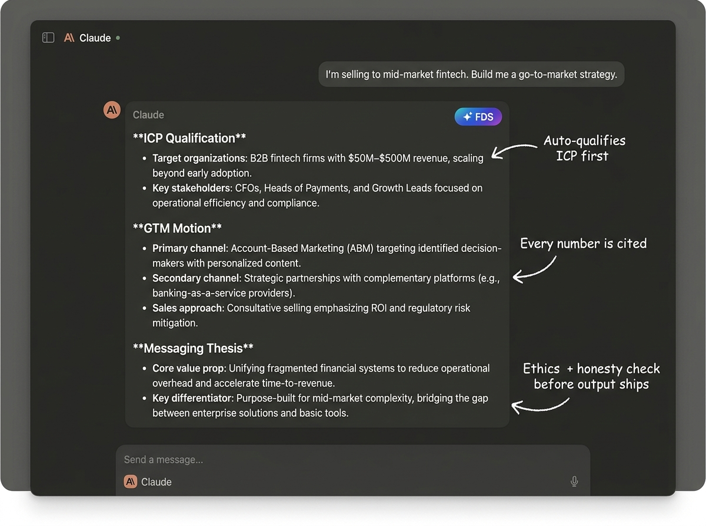

# Forward Deployed Selling

**Your buyer has AI. Sell like it.**

Forward Deployed Selling is the enterprise sales doctrine for a world where the buyer researched you, three competitors and the build-it-yourself option before your first email arrived. It replaces discovery with a thesis the buyer reacts to, and it ships as a Claude plugin your team and your agents run the same way.

[Install →](#install) · [Read the doctrine →](https://forwarddeployedselling.com/doctrine) · [What changed in 0.6 →](CHANGELOG.md)



---

## What you get

Twelve commands. Each one runs a protocol, checks what it needs first, and refuses to ship a number it cannot source.

| Say | Run | Get |
| --- | --- | --- |
| "Who should we be selling this to?" | `/fds:icp` | A qualified Ideal Customer Profile: market, persona, channel, disqualifiers |
| "Write something that earns the meeting" | `/fds:thesis <account>` | A sourced thesis and a one-page value provocation, every number labeled, independently reviewed |
| "Prep me for Thursday" | `/fds:profile <name> at <account>` | Who they are in the deal (User, Buyer, Sponsor, Enabler), what moves them, what blocks them |
| "Is this deal real?" | `/fds:score <account>` | Movement, readiness and velocity scores, a tier, and the next action |
| "It's gone quiet" | `/fds:revise <account> silence` | A signal diff, then either a revised thesis or the honest call that it's dormant |
| "Help me unstick this" | `/fds:coach <account>` | A five-section diagnosis for you, with nothing you'd be embarrassed to have the prospect see |
| "Should we walk away?" | `/fds:disqualify <account>` | A straight answer, and the note to send if it's no |

Also: `/fds:gtm`, `/fds:diagnose`, `/fds:frame`, `/fds:velocity`, `/fds:converge`. The full list with inputs and outputs is in [`skills/forward-deployed-selling/SKILL.md`](skills/forward-deployed-selling/SKILL.md).

## What makes it hold up

Most sales methodologies are advice. This one is enforced.

- **Every number carries a source or a confidence.** `KNOWN [url]` or `INFERRED [method] [confidence]`. A hook blocks any artifact that tries to ship a bare number.
- **The research can't invent a citation.** A separate research agent returns only pages it fetched. The thesis cites nothing it didn't return.
- **The work doesn't grade itself.** A reviewer agent that did not write the artifact scores it against the five Output Standards and the Pride Test ("if the prospect asked how you knew that, would they be impressed or uneasy?").
- **Pressure gets surfaced, not swallowed.** "Skip the relationship stage, quarter's on the line" triggers the Doctrine Constraint Layer: the agent names the rule, states the cost, and asks you to confirm. You can still do it. You can't do it silently.
- **Silence has a rule.** The response window is computed per account (industry, deal size, seniority, channel, season), and reaching it triggers a signal check, never a nudge.
- **It keeps score on itself.** Every artifact that ships writes one line to a ledger with its prediction. That ledger is what turns the doctrine's design targets into measured benchmarks over time.

## Install

**Claude Code** (recommended; commands, agents and hooks all work):

```
/plugin install forward-deployed-selling --marketplace vonarmen-wq/forward-deployed-selling
```

Then `/fds:icp` to start. `examples/getting-started.md` has a prompt for every command.

**Claude.ai and Cowork**: upload the `skills/forward-deployed-selling/` folder under Settings → Capabilities → Skills. The doctrine, protocols, schemas and examples work; the slash commands, hooks and reviewer agent are Claude Code features.

**Agent SDK / your own agents**: import `schemas/` for typed inputs and outputs, and `agents/doctrine-reviewer.md` as a reusable grader. The protocols are plain markdown.

## Measured, or marked

Performance figures in the doctrine (response rates, cycle compression, artifact effort) are labeled `[design target]` until the ledger holds thirty or more records for that claim. `KNOWN_ISSUES.md` lists each one. 0.6 ships the instrumentation; the first field benchmarks are the 0.7 milestone.

## About

Angel Armendariz is a twenty-year enterprise sales practitioner and Innovation Advisor to Fortune 500 enterprises. Field experience inside AWS, Saxony Partners and Endava shaped the doctrine; this plugin operationalizes it. Author of *Forward Deployed Selling*.

Apache 2.0. The "Forward Deployed Selling" name and "FDS Certified" mark are protected; see [license](https://forwarddeployedselling.com/license). Repo layout and design: [`ARCHITECTURE.md`](ARCHITECTURE.md). Contributing and evals: [`CONTRIBUTING.md`](CONTRIBUTING.md).
